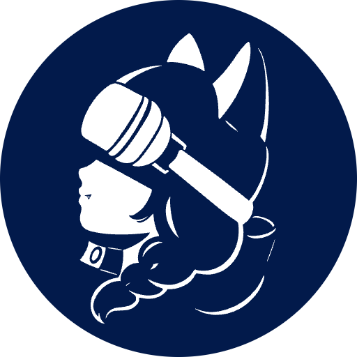
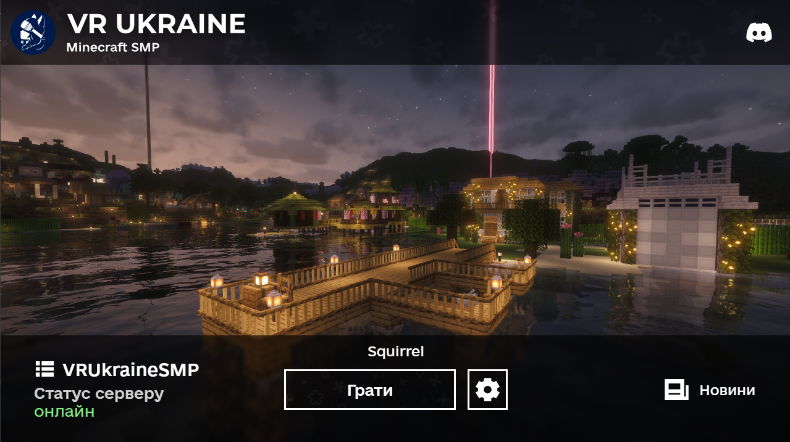

<h1 align="center">VR Ukraine Minecraft Launcher</h1>
<h3 align="center"> <i>slightly modified</i> Fork of <a href="https://github.com/dscalzi/HeliosLauncher">Helios Launcher</a></h3>

Кастомний Майнкрафт лаунчер для спільноти <a href="https://discord.gg/vrukraine">VR Ukraine</a>

## Особливості
- Тільки для своїх (_користуватись лаунчером можуть лише учасники спільноти_)
- Автоматичне оновлення/додавання наших збірок та серверів (_просто запусти, почекай і все встановиться автоматично для тебе, більше ніяких кодів чи zip архівів_)
- Свій дизайн (_щоб ви почувались вдома_)
- Йохохо режим ;)

## Подяки
- __Noted5__ - за оновлений дизайн та іконки
- __StaperFeed__ - за реалізацію оновленого дизайну
- __PIKA__ - за круті арти, що будуть радувати ваші очі під час старту
- __Ilad6__ - за скріни наших баз для фонів та тестування

## Скачати

Скачати лаунчер можна на сторінці [Релізів Github](https://github.com/squirrel-vr/HeliosLauncher/releases)
